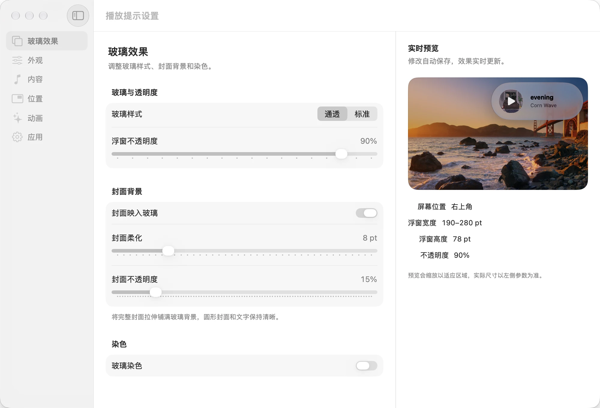

# 播放提示

**换歌时，在屏幕顶部轻轻提示一下。**

一个只做一件事的原生 macOS 小工具：系统正在播放的歌曲变化时，在屏幕顶部弹出一个 Liquid Glass 小浮窗，显示歌名、歌手和封面，默认 1.5 秒后自动消失。

作者：[Andyshenjx](https://github.com/Andyshenjx) · **macOS 26+** · **Apple Silicon** · 免费使用

介绍网站：<https://andyshenjx.github.io/PlaybackCue-Mac/>

## 界面展示

### 换歌浮窗

实际录屏：换歌时弹出；播放时封面变大，暂停时封面中央显示播放图标。

开启「封面映入玻璃」后，浮窗在桌面壁纸上的效果。

### 设置与实时预览

## 下载与安装

前往 [Releases](https://github.com/Andyshenjx/PlaybackCue-Mac/releases/latest) 下载 **PlaybackCue-1.0-macOS-arm64.dmg**，打开后把「播放提示」拖进「应用程序」文件夹。

- 需要 **macOS 26 或更新版本**，以及 **Apple Silicon（M 系列）Mac**。
- 下载包直接来自作者本机现有的 App（2026-11-19 构建），本次发布没有重新编译或运行验证。
- 当前没有 Developer ID 签名和苹果公证。第一次打开如果被系统阻止：先确认是从本页下载的，然后打开「系统设置 → 隐私与安全性」，在页面下方点「仍要打开」。
- 第一次读取 Apple Music 封面时，系统可能询问是否允许「播放提示」控制「音乐」，选「允许」即可。之前点过拒绝的话，可以在「系统设置 → 隐私与安全性 → 自动化」里重新打开。

打开后会显示设置窗口。App 不在 Dock 和菜单栏显示图标；关掉设置窗口后仍在后台监听换歌，想再改设置，在「应用程序」或启动台里重新打开它即可。要彻底退出，在设置的「应用」分类里点「退出播放提示」。

## 功能

| 模块 | 能力 |
| --- | --- |
| 换歌提示 | 切歌、或从没有播放变为开始播放时弹出；启动时不弹窗；显示时长可调，可选暂停后保持显示 |
| 浮窗内容 | 歌名、歌手、圆形封面、封面中央播放状态图标，各项都可单独开关 |
| Liquid Glass | 系统原生玻璃，可选「通透」或「标准」；可开启玻璃染色、自选颜色和浓度 |
| 封面映入玻璃 | 把封面柔化后铺进玻璃背景，可调柔化程度和不透明度 |
| 位置与尺寸 | 左上角 / 顶部中央 / 右上角；水平和顶部边距；动态宽度、最大宽度、高度、文字大小、阴影、整体不透明度 |
| 动画 | 出入场模糊强度可调，显示完成后文字和封面保持清晰 |
| 设置窗口 | 玻璃效果、外观、内容、位置、动画、应用六个分类；右侧用当前歌曲和系统壁纸实时预览，修改自动保存 |
| 封面来源 | Apple Music 直接读取封面；拿不到时从 Apple 公开的 iTunes 目录补取；最近几首的封面会缓存 |

## 支持的播放器

| 播放器 | 情况 |
| --- | --- |
| Apple Music | 支持，封面通过 Music 直接读取 |
| Spotify | 支持 |
| 其他播放器 | 取决于系统是否向第三方应用提供正在播放的信息，未逐一测试 |

## 它不会做的事

- 不做灵动岛 / 刘海区扩展。
- 不接管音量、亮度、键盘背光或媒体按键。
- 浮窗不抢键盘焦点，不打断你正在用的 App。
- 不占 Dock 图标和菜单栏；没有持续轮询，只在收到播放变化通知时读取。

## 隐私

- 不收集、不上传任何使用数据，没有统计或分析代码。
- 只有当播放器提供不了封面时，才会用歌名、歌手、专辑（或歌曲 ID）查询 Apple 公开的 iTunes 目录（`itunes.apple.com`）下载封面图片。
- 读取 Apple Music 只使用只读的 Apple Events，不会修改你的资料库。

## 技术说明

歌曲信息来自 macOS 的私有 `MediaRemote` 框架，并监听 Apple Music / Spotify 发出的系统通知。因为用到私有接口，本应用不能上架 Mac App Store，苹果以后更新系统也可能让部分功能失效。

本仓库只发布安装包，不包含源码。

## 赞赏

如果这个小工具对你有帮助，可以自愿赞赏支持维护。赞赏不影响任何功能。

## 反馈与免责声明

欢迎通过 [Issues](https://github.com/Andyshenjx/PlaybackCue-Mac/issues) 提交问题，请注明 macOS 版本、Mac 芯片、使用的播放器和复现步骤。

本软件按「原样」提供，不附带任何担保。Apple Music、Spotify 等名称归各自权利人所有，本项目与它们无关联。
